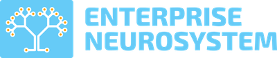

  

  <strong>Internet of Nature · Planetary AI · Equal Access for All</strong>

  <a href="https://www.enterpriseneurosystem.org">Website</a> ·
  <a href="https://www.enterpriseneurosystem.org/The-Enterprise-Neurosystem-Whitepaper.pdf">Whitepaper</a> ·
  <a href="https://medium.com/the-enterprise-neurosystem-blog">Blog</a> ·
  <a href="https://github.com/Enterprise-Neurosystem">GitHub</a> ·
  <a href="https://www.enterpriseneurosystem.org/contact">Contact</a>

---

## About

The **Enterprise Neurosystem** is a non-profit, open-source AI research community. It is
founded on the principle that all the species and ecosystems on this planet are part of a
single system.

Climate change affects that whole system, so understanding it takes a planetary view. The
Enterprise Neurosystem is building a single global AI architecture for environmental
intelligence. It links satellites with atmospheric, oceanic, seismic and agricultural sensors,
giving every nation accurate early warnings and recommendations for course correction.

The community brings together more than **190 researchers and engineers** from over
**30 companies and academic institutions**, including Stanford SLAC, UC Berkeley, IBM Research,
Intel, Meta, EY, Reliance Jio, Seagate, Verizon and Yahoo.

## The vision

- **An Internet of Nature.** Analyze natural systems at global scale to understand
  environmental impacts on the world's plant and animal species.
- **Equal access for all nations.** Give developing nations the same shared AI models,
  historical data and analysis that today only a few wealthy countries have. Local and
  indigenous knowledge of habitats and species is shared on each nation's own terms.
- **Early warning and course correction.** Surface patterns such as deforestation, drought,
  flood risk, wildfire risk, soil moisture, pollution and species population change early
  enough to act on them.
- **A Rosetta Stone for nature.** Over time, analyze acoustic and behavioral communication
  across thousands of species in search of shared patterns.

## How it works

1. **Sense.** Existing satellites and observation networks work alongside new sensors placed
   among key species, forests, crops and waterways.
2. **Cross-correlate.** Sensor data flows to AI instances in each country. Those instances
   analyze patterns in real time and compare the data with historical records for the area.
3. **Warn and advise.** Deeper patterns emerge from the combined data, supporting accurate
   early warnings and recommendations for species preservation, agricultural resilience and
   water resource management.

## Projects

### Uganda National AI Sensor Network

This work is led with Uganda's Ministry of Science, Technology and Innovation, together with
JPL/Caltech and Makerere University. It is a national network of environmental sensors, and it
has been approved for funding. It begins with two sites:

- the Bwindi Impenetrable Forest, home to the mountain gorillas
- a robotic AI sensor monitoring algal blooms on Lake Victoria

All data remains in Uganda, shared on Uganda's own terms.

As part of this work, the Enterprise Neurosystem and Uganda's Crane AI Labs developed an
**Atomic Language Model**. The model is 50KB in size, is based on Ugandan (Bantu) languages,
and runs on low-power devices such as sensors and 2G phones.

### Dangermond Preserve, California

This is the first deployment of the Enterprise Neurosystem architecture in the United States,
in partnership with JPL/Caltech and The Nature Conservancy. It combines satellite data,
atmospheric readings, ground sensors and multi-species analysis in one data fabric.

### Natural Language Interaction Protocol (NLIP)

NLIP is a protocol for communication between AI agents. It began as an Enterprise Neurosystem
community project and has since been adopted by Ecma International as a standard and working
group. It is backed by Cisco, Hewlett Packard, Hitachi, IBM, Microsoft, Red Hat and several
academic institutions.

### Research workstreams

- **Acoustic analysis and beehive sensors.** IBM Research's AI acoustics software, used to
  monitor hive health.
- **Mycorrhizal network sensors.** Studying electrical signalling in underground fungal networks.
- **Satellite data networking.** Tracking ocean pollutants, methane plumes and mass changes
  with JPL.
- **Telecommunications research.** Developing AI-enhanced 5G/6G frameworks for remote data
  transmission.
- **Neurological framework.** Applying brain-communication research to AI and network
  architecture.

## Global engagement

- Built and hosted the **UNFCCC AI Innovation Grand Challenge** with the UNFCCC Technology
  Executive Committee and the Climate Technology Centre and Network (CTCN). The challenge
  supports AI innovators in developing nations.
- Supports the **UNFCCC Technology Mechanism AI for Climate Action Award**, which recognizes
  open-source AI solutions in least developed countries and small island developing states.
- Participates in the **UN and ITU Early Warnings for All** initiative.
- Partnered with the **UAE and the USDA** on an AI Grand Challenge for smart agriculture.
- Co-created enablement initiatives at **COP 28** and **COP 29**, and delivered keynotes at
  Africa Climate Week and Asia Pacific Climate Week.

## Governance

The Enterprise Neurosystem operates under a public charter.

- A **Governing Board** sets the strategic direction.
- A **Technical Committee** oversees technical direction.
- Technical participation is open to anyone who follows the charter.
- Technical Committee meetings are held in public and documented.
- The platform is licensed under **Apache 2.0**.
- Documentation is published under **Creative Commons CC BY**.

The full charter and the list of board members are published on the
[website](https://www.enterpriseneurosystem.org/charter).

## Get involved

Our consortium is a community, welcome to all. The Enterprise Neurosystem is looking for:

- philanthropic partners
- volunteer scientists
- AI engineers
- network architects

To support the mission, contribute your expertise or join the network, visit
[enterpriseneurosystem.org/contact](https://www.enterpriseneurosystem.org/contact).

## About this repository

This repository contains the source for
[enterpriseneurosystem.org](https://www.enterpriseneurosystem.org), the Enterprise
Neurosystem's official website.

## License

The website's source code is licensed under the [Apache License 2.0](LICENSE).

Written content, photographs, logos and other media remain the property of the Enterprise
Neurosystem and their respective owners. They are not covered by this license.
